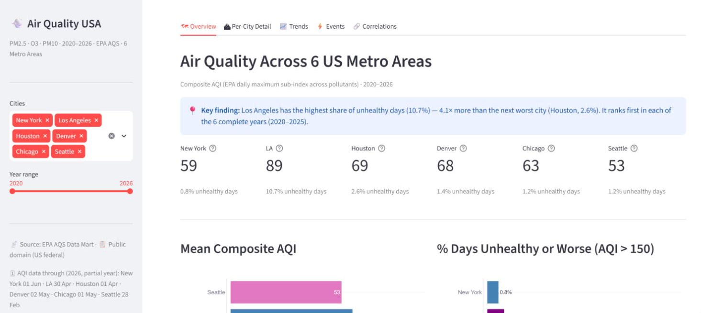

# Air Quality USA — Comparative Analysis Across 6 Metro Areas

An interactive Streamlit dashboard and analytical notebook exploring PM2.5 and AQI trends across six major U.S. metro areas from 2020 to 2026, using EPA AQS data.

**Live dashboard:** [air-quality-usa.streamlit.app](https://air-quality-usa.streamlit.app)



---

## Overview

This project analyses daily PM2.5, PM10 and Ozone measurements for Los Angeles, Seattle, New York, Chicago, Denver and Houston — covering roughly 2,300 days per city (2,251 to 2,344 days of AQI data, January 2020 through spring 2026; the AQI series end between 28 February and 1 June 2026 depending on the city, and the raw pollutant series run to late July 2026, except New York's PM10 and PM2.5, which end in March and April). It combines EPA monitoring records with meteorological event data to surface patterns, long-term trends, and risk-relevant insights for climate analytics, insurance and ESG portfolio screening.

Cities are identified by their EPA Core-Based Statistical Area (CBSA): for example, "California" in the internal data refers to the Los Angeles–Long Beach–Anaheim CBSA.

**Key questions explored:**
- Which cities exceed EPA air quality standards most often (and, in the dashboard scorecard, the WHO guideline)?
- Are PM2.5 levels improving, worsening, or flat over time?
- Do weekends consistently show lower pollution than weekdays?
- How do wildfire smoke and long-range transport events (e.g., Quebec 2023) affect local AQI?
- What is the order-of-magnitude health economic cost of observed exceedances?

---

## Key Findings

1. **Los Angeles is in a different tier entirely.** Mean AQI 88.8 vs 53.5–69.1 for the other five cities. 10.7% of days exceeded the "Unhealthy" threshold — roughly 4–14× the rate of every other city (Houston: 2.6%, the next highest). This chronic gap, not any single event, is the headline finding.

2. **"Worst day" and "worst pattern" are different things.** Seattle has the lowest mean AQI of all six cities (53.5) yet recorded the single highest AQI in the dataset (362, Hazardous, Oct 19 2022) — a city clean most of the year, punctuated by extreme, short-lived wildfire smoke events.

3. **The June 2023 Quebec wildfire smoke event reached both New York and Chicago**, confirmed independently in both cities' top-10 worst-AQI tables (NY: June 6–8, AQI up to 278; Chicago: June 27–28, AQI up to 246). Surface winds on the event days did not point toward Quebec; this is consistent with smoke carried at altitude (an interpretation, since ground stations do not observe upper-air transport), a cross-border transported risk not captured by local emission monitoring.

4. **No city shows a statistically significant trend at the 95% level** over the complete years 2020–2025. Houston comes closest, with a marginal upward trend (Mann-Kendall τ=+0.733, p=0.056), consistent with its mean AQI rising from 62.0 in 2020 to 74.9 in 2024. California and Seattle trend downward but not significantly (τ=−0.467, p=0.272). With only 6 annual data points the test has limited power, so this does not rule out real underlying trends. 2026 is excluded because it is a partial year.

5. **The weekday–weekend AQI gap is real in four of six cities.** Houston (+4.50 AQI), Chicago (+4.27), Denver (+3.84) and New York (+3.38) all show positive gaps with 95% CIs entirely above zero. California and Seattle show no detectable gap — both are dominated by wildfire smoke, which has no weekly cycle.

6. **Screening-level health cost estimate: USD 58.1 billion and about 4,438 attributable deaths (2020–2026)** across the six metro areas (California 27.3B and 2,081 deaths, Chicago 11.3B and 863, Seattle 9.8B and 750, New York 7.9B and 603, Houston 1.3B and 96, Denver 0.6B and 45). California accounts for the largest single-year figure (USD 11.2B in 2020). For the June 2023 Quebec smoke event, counting only the documented event days (New York 6–8 June, Chicago 27–28 June), the estimate is USD 5.5B in New York and USD 2.6B in Chicago; counting every PM2.5 exceedance day of 2023 it is USD 7.2B and USD 4.3B, a total that also includes days outside the event windows. On three days alone, New York's event cost is comparable to Seattle's entire 2020 (USD 5.9B).

> All health economic figures are screening-level estimates using the Pope et al. 2002 concentration-response function (6%/10 µg/m³) and HHS VSL USD 13.1M (2024). See methodology section below.

---

## Dashboard Tabs

| Tab | What it shows |
|-----|---------------|
| **Overview** | Mean AQI and % unhealthy days by city, AQI category breakdown, summary table and a risk scorecard (share of days above AQI 150, PM2.5 98th percentile and mean, days above the WHO guideline, Mann-Kendall / Theil-Sen trend direction, primary driver) |
| **Per-City Detail** | One city at a time: daily AQI with 30-day rolling mean, top 10 worst days, seasonal pattern by pollutant, year-by-month AQI heatmap |
| **Trends** | Annual mean AQI by city with Mann-Kendall significance and Theil-Sen slope, plus the weekday-minus-weekend gap with 95% bootstrap confidence intervals |
| **Events** | Documented high-AQI episodes (wildfire smoke, summer ozone) with surface wind context |
| **Correlations** | PM2.5 vs PM10 scatter with Pearson r by city, and the seasonal offset between PM2.5 and ozone peaks |

> **Note on 2026 data:** 2026 is a partial year and the cut-off differs by city: the AQI series end on 1 Jun (New York), 2 May (Denver), 1 May (Chicago), 30 Apr (Los Angeles), 1 Apr (Houston) and 28 Feb (Seattle) 2026. The sidebar shows these dates. Because a partial year covers only some seasons, trend tests (Mann-Kendall, Theil-Sen) use only the complete years 2020–2025, and the 2026 line is shown dashed. EPA data for 2026 are preliminary and not yet validated.

---

## Methodology

### Trend detection
- **Mann-Kendall test** for monotonic trend detection (computed with `scipy.stats.kendalltau`), applied to annual mean AQI values (6 points, 2020–2025). Reported as significant at p < 0.05 and marginal at p < 0.10
- **Theil-Sen slope** (dashboard only) for robust trend magnitude estimation (median of pairwise slopes)
- The Mann-Kendall test uses the complete years 2020–2025 in the dashboard, the notebook and the executive report (the Theil-Sen slope in the dashboard uses the same years); 2026 is excluded as a partial year (the AQI series end between February and June 2026) to avoid seasonal bias, because it lacks the summer and autumn months when the worst days occur (ozone and wildfire seasons, e.g. Seattle and Los Angeles)

### Weekend effect
- **Bootstrap 95% CI** (2,000 resamples, fixed seed 42) for the weekday vs. weekend mean AQI gap
- A gap whose CI crosses zero is reported as "no detectable gap", not as a reversal

### Population-weighted exposure
- **Person-days of PM2.5 exceedance:** county-level exceedance days (days with any monitor above 35 µg/m³, counted once per county per day) × county population (Census ACS 2022)
- Population data from the Census ACS 2022 API (variable B01003\_001E), summed over the counties included for each metro area: New York 22 (New York and New Jersey), Chicago 8, Denver 8, Houston 4, Seattle 3, Los Angeles 2. This county list follows the project's own region mapping and may not match the official Census CBSA delineation exactly
- Metric captures both the intensity of an event and the population exposed to it
- **Quebec 2023 event:** reported both on the documented event days only (New York 6–8 June, Chicago 27–28 June; the conservative reading) and for all exceedance days of 2023, so the two are never mixed

### Health economic screening model
- **Concentration-response function:** Pope et al. 2002 (ACS CPS-II cohort) — a 10 µg/m³ increase in long-term mean PM2.5 is associated with ~6% increase in all-cause mortality, applied here as 0.6%/µg/m³
- **Value of Statistical Life (VSL):** USD 13.1 million (2023 USD), U.S. Department of Health and Human Services standard regulatory value (HHS, January 2024)
- **Baseline mortality:** 833 deaths per 100,000 per year (CDC, 2022), applied uniformly to every city
- **Threshold:** EPA 24-hour NAAQS PM2.5 standard of 35 µg/m³
- **Calculation, per county and year:** attributable deaths = county population × baseline mortality × 0.006 × (mean of the monitor readings above 35 µg/m³, minus 35) × (exceedance days ÷ 365); deaths are summed over the counties of each metro area and multiplied by the VSL

**Important caveats:** The Pope et al. 2002 coefficient was derived from chronic long-term exposure studies, not acute events. Its application to exceedance days is a known simplification — it likely overestimates risk for short acute episodes and underestimates it for cities with sustained elevated background levels. These figures are appropriate for order-of-magnitude risk communication and portfolio screening, not for regulatory analysis.

Note: in January 2026 the EPA announced that it would stop monetizing PM2.5 health benefits in its regulatory analyses; the HHS VSL is used here as an alternative federal reference value.

---

## Data Sources

| Source | Content | Access |
|--------|---------|--------|
| **EPA Air Quality System (AQS)** | Daily PM2.5, O3, PM10 and AQI by CBSA, 2020–2026 | [aqs.epa.gov/aqsweb/airdata](https://aqs.epa.gov/aqsweb/airdata/download_files.html) — public download |
| **EPA AQS daily wind and temperature** | Surface wind speed and direction for the event months (`daily_WIND_{year}.csv`; temperature is downloaded but not used) | Same AQS download page — public |
| **Census ACS 2022** | County-level population used for person-days and per-capita figures | Census API — public (free key) |

Documented events (`events.csv`) were identified from the AQI data itself (the month with the most days above AQI 150 per city, plus separately noted extreme episodes). Processed data is stored in `data/processed/` as Parquet files. The raw EPA CSV downloads and the cached Census population file are not committed to the repo (large or regenerable), but everything can be rebuilt from the public downloads, see "Running Locally".

---

## Project Structure

```
air-quality-usa/
├── app.py                        # Streamlit dashboard (main deliverable)
├── air_quality_usa.ipynb         # Full analysis notebook
├── etl.py                        # Reads and normalizes the raw EPA CSVs
├── scripts/
│   └── build_dataset.py          # Builds data/processed/*.parquet from data/*.csv
├── regions.csv                   # The 6 metro areas, colours and pollution mechanisms
├── events.csv                    # Documented high-AQI events used in Section 6
├── requirements.txt
├── LICENSE                       # MIT
├── .gitattributes                # Excludes the notebook from GitHub language stats
├── .gitignore                    # Excludes .env, raw CSVs, cached Census data, caches
├── data/
│   └── processed/
│       ├── air_quality_usa.parquet   # Daily PM2.5 / PM10 / O3 readings by monitor
│       ├── aqi_by_cbsa.parquet       # Daily composite AQI by metro area (CBSA)
│       └── meteo_events.parquet      # Wind (and temperature) for the event months
├── docs/
│   └── executive_report.pdf          # Executive report (5 pages)
└── images/                       # Static chart exports
```

> **Note on `.env`:** A `.env` file with a `CENSUS_KEY` variable is used locally to access the Census API. It is listed in `.gitignore` and must never be committed to the repository.

---

## Running Locally

```bash
git clone https://github.com/AlonsoSheila/air-quality-usa.git
cd air-quality-usa
pip install -r requirements.txt
streamlit run app.py
```

To open the notebook you also need Jupyter (`pip install jupyterlab`), which is not needed by the dashboard.

The processed Parquet files are committed, so the dashboard and the notebook run without any download except the Census population file (see step 3).

To rebuild everything from the raw EPA data:
1. Download from [EPA AQS](https://aqs.epa.gov/aqsweb/airdata/download_files.html) the daily PM2.5, ozone and PM10 files for the six metro areas, the daily AQI by CBSA files (`daily_aqi_by_cbsa_{year}.csv`) and the daily wind/temperature files (`daily_WIND_{year}.csv`, `daily_TEMP_{year}.csv`) for 2020–2026 (the file names `etl.py` expects are listed at the top of that file; rename the EPA downloads accordingly, e.g. `pm25_2020_NewYork.csv`, using the `file_key` names from `regions.csv`)
2. Place them in `data/` and run `python scripts/build_dataset.py`
3. Obtain a free Census API key at [api.census.gov/data/key\_signup.html](https://api.census.gov/data/key_signup.html) and add it to `.env` as `CENSUS_KEY=your_key_here`; the notebook downloads and caches county populations in `data/external/` on its first run
4. Open `air_quality_usa.ipynb` and run all cells

---

## Analysis Sections

1. Setup and Data Loading
2. Data Quality Check
3. Headline Comparison: AQI Across Cities
4. Per-City Detail
5. County-Level Detail Within Each CBSA
   - 5.2 Population-Weighted Exposure: Person-Days of PM2.5 Exceedance
6. Documented Events: Wind Context
7. Cross-City Correlations
8. Year-Over-Year Trend
   - 8.2 Statistical Significance of Year-over-Year Trends (Mann-Kendall Test)
9. Weekday vs Weekend
10. Resolving the Open Questions From Section 4
11. Health Economic Impact Estimate
    - 11.1 Quebec Smoke Event: Event Days Only
    - Risk Implications for Business and Investment Decisions
12. Conclusions

---

## Technologies


Versions are those used for development (the notebook was last executed with Python 3.13); the dashboard requires Streamlit 1.51 or newer (see `requirements.txt`).

Methodology: Exploratory Data Analysis, Statistical Trend Detection (Mann-Kendall / Theil-Sen), Bootstrap Inference, Population-Weighted Exposure Analysis, Health Economic Screening

---

## About this Project

This project is part of a data science portfolio focused on Climate Risk Analytics, combining environmental datasets, statistical methods, and risk assessment frameworks.

## Author

**Sheila Alonso** — Environmental Data Analyst | Climate Risk & Sustainability  
[GitHub](https://github.com/AlonsoSheila) · [LinkedIn](https://www.linkedin.com/in/sheila-alonso-rodriguez/)
